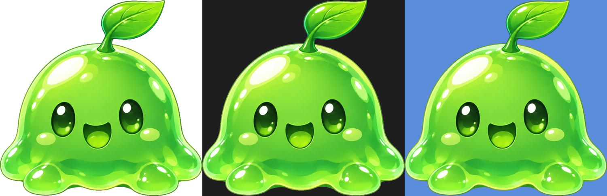

# codex-imagegen

A Claude Code skill that gives Claude image generation by delegating to
[Codex CLI](https://developers.openai.com/codex/cli/features)'s built-in `$imagegen`
tool, plus a chroma-key step for clean transparent PNGs.

Claude refines the request into a concrete prompt, runs Codex non-interactively in a
throwaway directory, collects the image, looks at it, and hands you the file path.

## Why the transparency trick

Generated "transparent background" images are unreliable: fake checkerboards, soft
halos, cast shadows. This skill asks for the opposite. The subject is painted on a flat
key color (green by default, magenta or blue when the subject is green). Then
`scripts/chroma_key.py` removes the background locally:

- samples the key color from the image border, so a slightly off-green background still works;
- removes all key-colored pixels, including pockets enclosed by the subject
  (`--keep-holes` limits removal to the border-connected background);
- gives edge pixels a soft alpha and un-mixes the key color from them, so there is no green fringe;
- optionally trims to the subject's bounding box.

The untouched key-color source is kept next to the result. You can re-key it with
different thresholds without generating the image again.



## Requirements

- macOS or Linux with bash
- [Codex CLI](https://developers.openai.com/codex/cli) logged in to a ChatGPT plan: `brew install codex && codex login`
- [uv](https://docs.astral.sh/uv/), used only for keying (Pillow and numpy are declared inline in the script): `brew install uv`

## Install

```bash
git clone https://github.com/ZQC8848/codex-imagegen-skill ~/Dev/tools/codex-imagegen-skill
ln -s ~/Dev/tools/codex-imagegen-skill ~/.claude/skills/codex-imagegen
```

Then just ask Claude Code: "生成一个火球技能图标，透明背景", "make a pixel-art key art of a wizard tower", "edit this
concept art to night time" (with an image path).

## Direct use

```bash
scripts/imagegen.sh -p "Cute green slime monster sprite, chibi, full body" -n green-slime -t -k magenta --trim
scripts/imagegen.sh -p "Same character, waving" -r ./green-slime.png -n green-slime-wave -t -k magenta
scripts/imagegen.sh -p "Pixel-art wizard tower at dusk, game key art" -s landscape -c 2
```

| Option | Meaning |
|---|---|
| `-p` | prompt (`-` reads stdin) |
| `-o` | output dir. Default: `<git root>/assets/generated`, else `~/Assets/generated` |
| `-n` | base file name |
| `-c` | number of images |
| `-s` | `square` \| `landscape` \| `portrait` \| `WxH` |
| `-r` | reference image (repeatable) for edits and consistency |
| `-t` | transparent output via key color + chroma key |
| `-k` | key color: `green` (default), `magenta`, `blue`, `#RRGGBB` |
| `--trim` | crop transparent output to the subject |
| `--timeout` | seconds, default 300 |

stdout is one absolute path per image. Exit codes: 3 = missing tool or not logged in,
4 = Codex failed or timed out, 5 = no image produced.

## Notes

- Uses your ChatGPT plan's image quota through Codex. In testing, one image took about 70 seconds.
- Codex runs with `--ephemeral` and a `workspace-write` sandbox in a temp directory. It never sees your project.
- Codex CLI's flags and image store layout can change between versions. This skill was built against `codex-cli 0.162.1`.

## License

MIT
